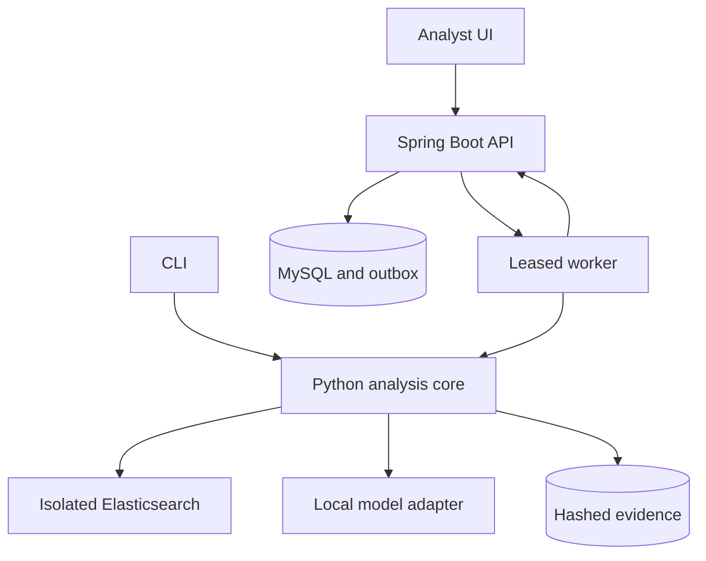

# CyberGuard Detection Repair Engineering Plan

AI assisted diagnosis and repair with independently validated security detections

Prepared for Ruthvik Bandari | Personal research and portfolio project | Version 2.0 | 10 October 2026

## Project decision

Build a local detection engineering platform that accepts a Sigma rule, a telemetry schema and labeled event fixtures; identifies why the detection fails or becomes noisy; proposes a minimal rule or mapping correction; and produces a reproducible before and after validation report. Reuse CyberGuard for analyst review, evidence, cases and audit history. Provide a CLI so the engine is useful without the web interface.

ML is a major research workstream: learn repair generation and candidate ranking from reviewed examples and execution feedback. Deterministic parsing, compatibility checks and replay remain the authority for measured behavior. A proposed change becomes exportable only after tests and analyst approval.

## First release

Support Windows process creation events, a bounded subset of single event Sigma rules, one pinned Elasticsearch query backend and uploaded JSONL fixtures. Demonstrate a broken field mapping, a noisy rule and missing telemetry. Add connector capability through explicit adapters rather than arbitrary shell execution.

## Delivery package

This plan defines scope, architecture, contracts, ML experiments, evaluation, security controls, operations, milestones and Claude Code development workflows. The companion ZIP contains the editable Markdown plan, 16 project skills, four optional review agents, project rules, a tested hook, templates and an installation guide. It is a development starter pack; the application and trained model remain implementation work.

Planning estimate: 16 weeks at 18 to 22 focused hours per week, with 20 percent of capacity reserved for integration and uncertainty. At 12 to 15 hours per week, plan approximately 24 weeks. The first complete deterministic workflow is the week 8 milestone. Industrial engineering practices are acceptance criteria, not a claim of production certification.


# 1 Scope and architecture decisions

The latest project direction supersedes the earlier network classifier and attack path proposals. A broad platform can grow around a coherent detection maintenance workflow once users find that workflow useful.

| Decision | Initial implementation | Later option |
| --- | --- | --- |
| Core problem | Diagnose, repair and validate detections | Coverage analysis and drift monitoring |
| Rule format | Bounded single event Sigma subset | Correlation rules and native Wazuh rules |
| Telemetry | Windows process creation JSONL | Zeek, Suricata and other schemas |
| Execution target | One pinned Elasticsearch backend | Wazuh or Splunk after demand |
| UI and case management | Existing Next.js and Spring Boot | New modules after core adoption |
| ML | Retrieval, fine tuned repair model, ranker | Preference optimization and distillation |
| Deployment | Local containers and local model serving | Reviewed institutional pilot |
| Database | Retain current MySQL for MVP | PostgreSQL only with a migration ADR |

## Explicit scope exclusions

No autonomous production rule changes, general purpose Kali agent, credential collection, live endpoint response or claim of guaranteed threat prevention. Attack path analysis, network flow classification, related incident search and cloud IAM are separate extensions. University GPUs train models; they do not justify building every module simultaneously.

## Working assumptions

Ruthvik is the primary implementer. H200 and A100 access is available under university scheduling and data policies. Only public or authorized lab telemetry is used initially. Ten reproducible failure cases and two practitioner trials precede extensive model training. If this workflow cannot demonstrate value, retain the benchmark and engine as a research contribution and revise the interface scope.

Release labels: prototype means demonstrated behavior on controlled fixtures; research release means a frozen evaluation and documented limitations; pilot means supervised use by named testers in an authorized environment.


# 2 Usefulness validation and competitive position

The opportunity is a hypothesis: smaller detection teams may need an easier way to connect schema diagnosis, minimal repair and regression evidence. Tool integration alone does not establish differentiation. Tracecat already provides security automation, and Sigma supplies conversion infrastructure. Build on those capabilities instead of recreating them. [R10, R12]

## Two week validation gate

- Interview 6 to 8 detection engineers, SOC practitioners or university security staff about a recent failed or noisy detection. Record the actual workaround, time spent, constraints and recurrence.
- Reproduce 10 distinct failure cases using shareable lab fixtures. For each, document the expected behavior, root cause, existing fix and why current tooling is inconvenient.
- Run maintained Sigma pipelines and an unmodified retrieval assisted model against the same development cases. Assess setup time and verification effort.
- Let 2 to 3 practitioners try one complete workflow. Measure active review minutes, mistakes, unanswered questions and whether they return for a second task.

| Evidence | Go criterion | Action if absent |
| --- | --- | --- |
| Recurring problem | At least 3 concrete recurring maintenance cases | Refocus failure family |
| Reproducibility | 10 labeled cases with executable expected results | Prioritize data collection |
| User benefit | 2 testers complete workflow and request another use | Simplify workflow or contribute upstream |
| ML need | Deterministic fixes leave meaningful ambiguous cases | Do not force an LLM into trivial mapping |

## Positioning

Describe CyberGuard as a personal detection repair workbench with measured research results. Potential value is reduced review effort with preserved tested behavior, explicit abstention and portable evidence. Do not present prior chat survey percentages as established project evidence: adoption claims require their own current sources and a relevant user sample.

Keep a validation log with anonymized task descriptions and observed times. Practitioner feedback is a small convenience sample, not proof of market demand or a guarantee of hiring.


# 3 Existing CyberGuard foundation

Baseline repository: tanishka-bandari/cyberguard, main commit 9d00c744420d4681fc199f053f29b0863e31a910, inspected 10 October 2026. Review covered README, dependency manifests, architecture, IncidentService, application properties and CI. This is source inspection, not an executed application audit. [R1]

| Observed component | Reuse | Required extension |
| --- | --- | --- |
| Next.js 16 and React 19 | Analyst UI, routing and case views | Rules, jobs, evidence and repair review |
| Spring Boot 4 and Java 21 | Authentication and business services | Versioned rule and repair domain |
| MySQL and JPA | Existing incident records | Managed migrations and durable jobs |
| JWT and access controls | USER, ANALYST and ADMIN model | Detection specific permissions |
| Evidence and audit services | Case evidence and change history | Immutable run provenance and retention |
| GitHub Actions | Backend tests and frontend checks | Python, engine integration and evidence checks |

## Important implementation findings

IncidentService accepts a riskScore from the reporter, validates 0 to 100 and stores it. It is not a model prediction. Add distinct diagnosis, model score, test result and analyst severity fields; do not silently reinterpret historical scores.

The backend configuration uses Hibernate ddl-auto=update. Introduce versioned migrations, capture an existing schema baseline and switch non-test environments to schema validation. Test forward migration and a backup restore before rollout.

Current CI runs backend tests plus frontend lint, type check and build. Add Python contract tests and a pinned Elasticsearch replay job. Preserve incident lifecycle and authorization regression coverage.

## Attribution and compatibility

Retain the upstream MIT license and attribution. Document exactly which components are inherited and which Ruthvik implements. Keep current dependency versions locked during the first workflow; resolve runtime compatibility before upgrading. Pin the upstream commit in the fork manifest and record future merges. Existing hosting instructions are not the local detection runtime design.


# 4 Functional requirements and acceptance

| ID | Required behavior | Acceptance evidence |
| --- | --- | --- |
| FR01 | Import versioned Sigma YAML and JSONL fixtures | Reject malformed, oversized and unsupported inputs |
| FR02 | Profile telemetry schema and coverage | List required, observed and missing fields with counts |
| FR03 | Diagnose the failure | Classify mapping, missing data, logic, noise or unsupported semantics |
| FR04 | Propose bounded changes | Return structured patch, explanation and abstention option |
| FR05 | Replay before and after | Persist expected and observed event matches for both |
| FR06 | Compare candidates | Rank only valid candidates; retain failures and rejections |
| FR07 | Review and export | Require role check, validated version and approval record |
| FR08 | Track regressions | Repeat suite on rule, parser or schema changes |
| FR09 | Expose CLI and API | Same core results and machine readable exit states |
| FR10 | Preserve case context | Link repair runs to an incident without changing severity |

## System constraints

All runtime analysis runs locally by default. Model generation may be disabled while deterministic diagnosis and replay continue. Imported content is untrusted data. An unavailable engine, unsupported operator or unlabeled fixture must produce an explicit non-success state. Never report a conversion success as proof that the detection works.

## Initial performance budgets

Engineering targets, to be measured on a recorded machine: ingest 100,000 events up to 250 MB within 120 seconds; replay one supported rule over that indexed set within 30 seconds warm; return a job acknowledgment within 1 second p95 at 5 concurrent submissions; generate at most 4 repair candidates within 90 seconds on a nominated inference host. Loading, indexing and model latency are reported separately. Exceeding a target creates a performance issue; it does not permit dropping events.

Support a 10,000 event laptop demo as the minimum verified profile. Initial ceilings are 250 MB uncompressed per telemetry job, 100 KB per rule file and 2 worker jobs concurrently; tune from measured memory and engine behavior.


# 5 Analyst workflow and supported semantics

- Select an existing incident or create a detection investigation; upload a rule, schema profile and labeled fixture collection.
- Review static findings and coverage first. If required information is not collected, show a telemetry recommendation and abstain from a rule repair.
- Replay the original detection; inspect missed malicious events, benign matches, unknown labels and execution errors.
- Generate bounded rule or pipeline candidates; review a diff and the evidence used for each proposal.
- Replay candidates on development fixtures; freeze the selected artifact and run an independent validation suite.
- Approve an exact hash and export a patch plus evidence bundle. Apply to any production engine outside the MVP, through the organization's change process.

## Version one semantics

Begin with process creation logs in Windows Sysmon EventID 1 style and an ECS mapped lab variant. Allow named selections, exact values, lists, contains, startswith, endswith and simple Boolean selection combinations only when the pinned backend and fixtures verify their behavior. Define null, missing field, case and array handling with explicit tests. Reject aggregation, correlation, regex, exotic modifiers and unsupported log sources initially.

Do not construct a substitute Python matcher and call it equivalent to Elasticsearch. Golden fixtures execute through the actual supported engine. Conversion targets and pipelines are pinned and covered by a compatibility matrix. [R10, R11]

## Three mandatory demonstrations

Mapping drift: a field exists under a new name, and an environment pipeline correction restores matching. Noise: a legitimate updater is matched; a narrow contextual condition reduces known benign matches while attack variants remain detected. Missing telemetry: command line logging is absent; CyberGuard identifies insufficient evidence and offers collection guidance without inventing a fix.

Each demonstration includes a healthy reference, an impaired original, a proposed change and previously unseen test fixtures. Match improvements on the development set alone are labeled provisional.


# 6 Runtime architecture and trust boundaries

Retain the existing UI and business backend. Add one Python analysis package shared by FastAPI endpoints, a worker and the CLI. Keep model inference replaceable and separate from deterministic validation.



Spring Boot owns identity, authorization, rule versions, jobs, approvals and audit records. In one database transaction it creates a job and an outbox entry. A dispatcher offers work through an authenticated internal claim API. The Python worker leases a job, calls the shared core, writes a content addressed artifact and submits a completion record. The backend validates ownership and the current lease before accepting it.

A pinned local Elasticsearch instance executes generated read queries over isolated test indexes. The fixture loader has write permission only to designated disposable indexes. The query worker is read only. A local model service receives bounded, sanitized context and returns structured candidates; it receives no database credentials or shell tools.

## Storage and failure isolation

MySQL stores business metadata and job state. A persistent local artifact directory stores rules, telemetry, model manifests and replay evidence under hashes. MLflow is optional for experiment tracking and never the source of approval truth. Models, jobs and evidence retain independent version identifiers.

The browser reaches only the existing application origin. Internal APIs are bound to a private container network or loopback and authenticate service identities. Production telemetry connectors are absent by default. Model failure must leave static diagnosis, original replay and evidence inspection available.


# 7 Domain model and provenance

| Entity | Required fields | Invariant |
| --- | --- | --- |
| RuleVersion | id, rule id, content hash, parent, format, author | Immutable content after creation |
| SchemaProfile | id, source, field types, coverage, mapping hash | Source and normalization remain traceable |
| DatasetVersion | id, files, hashes, license, labels, split manifest | Raw data cannot silently change |
| FailureCase | root id, rule family, scenario, fault, expected behavior | All variants share a split group |
| RepairProposal | id, original hash, patch, basis, model and prompt ids | Proposal is separate from approval |
| ValidationRun | id, proposal hash, suite hash, engine and metrics | Run refers to exact executable artifacts |
| Approval | actor, proposal hash, validation id, time, decision | Stale validation invalidates export |
| Job and Outbox | id, state, lease, attempts, idempotency key | Backend owns transitions |
| ConnectorConfig | id, type, allowlisted endpoint, credential ref | No credentials in evidence or prompts |

## Score and label separation

Keep analyst severity, reporter risk score, model ranking score and measured replay metrics distinct. A ranker score is not a probability unless calibrated against held-out labeled data. Diagnosis confidence is optional and must disclose its calibration status.

Every run manifest records git SHA, rule and pipeline hashes, dataset and split IDs, model revision, prompt version, dependency lock hash, engine image digest, seed, hardware, start and end time and failure status. Evidence contains event IDs and reason codes; access to raw payloads is separately controlled.

## Artifact integrity

Write artifacts to temporary paths, compute SHA-256, atomically finalize and then acknowledge completion. Store only immutable content references in successful jobs. Verify hashes when loading; never deserialize untrusted pickle files. Training uses reviewed checkpoints with pinned revisions and explicit license records.


# 8 API contracts and durable jobs

| Proposed route | Contract | Authorization |
| --- | --- | --- |
| POST /api/v1/rules | Import immutable rule version | ANALYST or ADMIN |
| POST /api/v1/datasets | Import authorized fixture set | ANALYST or ADMIN |
| POST /api/v1/diagnoses | Create job with exact rule and data versions | ANALYST or ADMIN |
| POST /api/v1/repairs | Generate candidates from diagnosis id | ANALYST or ADMIN |
| POST /api/v1/validations | Execute frozen candidate and suite | ANALYST or ADMIN |
| GET /api/v1/jobs/{id} | Return state, counters and evidence refs | Authorized project reader |
| POST /api/v1/approvals | Approve exact proposal and run hashes | ANALYST or ADMIN |
| GET /api/v1/exports/{id} | Export approved evidence and patch | Authorized analyst |
| /internal/v1/jobs/* | Claim, heartbeat and complete a lease | Scoped service identity |

These are new routes to implement. Existing incident APIs remain compatible. Use OpenAPI and typed DTOs with explicit schema versions; Python validates internal envelopes with Pydantic. The CLI invokes the same core workflow and can emit JSON without requiring the web stack.

## Job behavior

States: queued, running, succeeded, failed, canceled and expired. Domain outcomes within a completed job include repaired, unchanged, abstained, unsupported and insufficient_evidence. Require idempotency keys on job submissions and compare and set transitions on completion. Retry transient infrastructure failures at most twice with backoff; do not retry invalid rules or missing required fields.

A worker heartbeats every 15 seconds on a 90 second lease. Expired jobs may be reclaimed. Attempts write separate temporary directories; only one matching lease completion becomes authoritative. Cancellation is cooperative between indexing, inference and replay steps. Cap wall time at 10 minutes per MVP job.

Return 202 plus a job URL for accepted work, 400 for invalid inputs, 401 or 403 for access violations, 409 for stale versions and 413 for size limits. Paginate event results and redact stack traces from user responses.


# 9 Deterministic diagnosis and repair bounds

## Diagnosis sequence

- Parse Sigma and construct a rule AST. Verify required structure, log source and allowed operators before conversion.
- Resolve the environment processing pipeline; map rule fields to observed schema fields using reviewed mappings first.
- Profile presence, types, cardinality and nulls. Distinguish absent fields from fields present with no matching values.
- Compile and execute the original rule. Preserve parse errors, query errors, execution timeouts and partial results as separate findings.
- Identify a likely failure family using schema evidence and labeled match differences. Return multiple hypotheses when evidence is ambiguous.

## Repair classes

Prefer an environment mapping patch when a source field was renamed; preserve portable detection logic. A rule patch may correct a value type, overly broad selection or reviewed contextual exclusion. A telemetry change is a recommendation outside the automatic repair contract. Unsupported semantics produce no candidate.

Candidates may change only named selection values, selection conditions or an approved mapping transformation. Reject arbitrary code, unknown fields, new external resources, disabled selections, deletion of the entire condition and excessive edits. Limit candidates to four and initial edits to three AST nodes; exceptions require a documented research case.

## Structured candidate output

```text
proposal_id; original_sha256; patch_kind; patch
reason_codes; evidence_event_ids; assumptions
model_revision; prompt_sha256; abstained; abstention_reason
```

Validate the candidate envelope, apply it to an immutable copy, parse again, compile and replay. The explanatory text never substitutes for evidence. A candidate that reduces false positives by preventing all matches fails preservation tests.

Negative controls include always true, always false, unknown field substitution and benign overfitting. They must fail the validation policy. Rank passing candidates by preserved attack scenarios, benign match reduction and smaller edits. No passing candidate means abstain.


# 10 Replay harness and validation policy

A replay run means ingesting labeled event fixtures and executing the converted query in the supported engine. Generating attack activity is a separate optional lab process; it is not required for routine replay.

## Engine fidelity

Load events into a run specific index with fixed mappings and stable event IDs. Wait for refresh and verify the indexed count against the input manifest. Execute the exact compiled query with pagination sufficient to retrieve every match. Compare observed IDs with fixture expectations. Keep query errors, truncated results and missed events visible.

Test engine behavior for missing fields, case sensitivity, array values, keyword versus analyzed fields, escaping, Unicode, timestamps and Boolean logic. Different pipelines or engine versions require a new compatibility run. Conversion output alone is not a correctness oracle.

## Acceptance policy

- All mandatory positive scenarios match and all mandatory negative controls behave as specified.
- No loss of previously detected mandatory attack scenarios; ambiguous labels are reported separately.
- Schema compatibility and query execution succeed without truncation, hidden errors or unsupported operators.
- Noise repairs reduce independently labeled benign matches on the specified suite; the healthy reference provides the expected baseline.
- The exact candidate hash, mapping hash and suite hash are frozen before validation. Any subsequent edit invalidates its approval.

## Report content

Persist original and repaired match IDs, TP, FP, FN and TN for labeled events; attack scenario coverage; unlabeled counts; parse and engine errors; query text; mapping versions; diff; timing and abstention reason. A passed suite establishes behavior only on its tested scenarios. Zero observed false positives in a small sample does not establish a zero production false-positive rate.

Synthetic fixtures are unit tests. Public recorded telemetry and supervised lab events form additional independent validation layers. A suspected false positive must have a reviewed benign label, not merely an unrecognized attack label.


# 11 Data collection and benchmark design

NSL-KDD and UNSW-NB15 flow tables do not provide the process event context required for this task. Use pinned Sigma rules, selected OTRF recorded telemetry, independently labeled benign lab activity and documented Atomic Red Team test captures where authorized. Each source contributes a different kind of evidence. [R10, R13, R14]

## Version one benchmark

Target 60 clean rule scenario roots with approximately 3 impairment variants each, producing about 180 cases. These are planning targets, not acquired data. Include field rename or type changes, noisy predicates, selection logic faults and missing telemetry. Retain healthy reference behavior and at least two attack variants plus multiple benign confounders where feasible.

Assign 36 roots to training, 12 to development and 12 to locked test before generating variants. Group related rule families and near duplicates together; if grouping reduces the available sample, reduce scope or collect more data. A second held-out schema provides cross environment testing. All corruptions, healthy versions, prompt examples and generated candidates from a root remain in the same partition.

## Label and license record

- Record source URL, commit or revision, original license, allowed use, capture method and collection date.
- Mark event labels as malicious, benign or unknown, plus scenario ID, rule relevance and reviewer rationale.
- Track fault provenance separately as natural, lab introduced or synthetic. Report results separately by provenance.
- For mapping and missing telemetry labels, require the expected schema and a reviewable root cause. Have a second reviewer adjudicate a sample and disagreements.

Synthetic corruption measures controlled robustness; it cannot substitute for naturally occurring maintenance cases. Fine tuning data can expand to 1,000 to 3,000 reviewed candidate examples from training roots, but these remain correlated examples, not thousands of independent incidents.

Freeze dataset hashes and split assignments. Keep raw test inputs outside Claude's working tree and provide only aggregate test reports after final evaluation.


# 12 ML architecture and training sequence

## Primary research question

Does execution supervised model adaptation improve independently validated repair success and reduce analyst review time compared with maintained mappings, retrieval assisted prompting and an unmodified open model under the same evidence and candidate budget?

| Stage | Method | Reason to proceed |
| --- | --- | --- |
| B0 | Maintained mappings and deterministic diagnostics | Required non-ML baseline |
| B1 | Lexical and embedding retrieval of reviewed training repairs | Establish retrieval contribution |
| B2 | Unmodified open model with structured output | Measure generation without training |
| M1 | Supervised fine tuning with LoRA or QLoRA | Enough reviewed training data and a remaining failure gap |
| M2 | Learned candidate ranker with execution features | Ranking errors limit selection quality |
| M3 | Preference optimization such as DPO | Reliable chosen and rejected candidate pairs |
| M4 | Distillation and quantized inference | Best model has useful gains and accessible deployment |

Start with a licensed 7B to 14B instruction or code model selected from current candidates during implementation. Record exact model repository, revision, license and tokenizer; do not assume a particular future model exists. A larger 24B to 32B comparison is optional after measuring the smaller model. HPC availability is not a model selection metric.

## Training examples

Input: failing rule, reviewed schema summary, original replay findings and retrieved training examples. Target: bounded rule or mapping patch, evidence references and abstention when no valid repair exists. Include unsupported and missing telemetry cases. Preserve rejected candidates and their error types.

SFT uses the training partition only. A ranker may use AST edit distance, schema validity and development replay features available at selection time; it must not see locked test outcomes. Preference pairs combine developer suite results and reviewer judgments so passing a narrow suite cannot become the only reward. [R15, R16]


# 13 Experiments and statistical evaluation

| Metric | Definition | Reporting rule |
| --- | --- | --- |
| Validated repair success | Fully accepted repairs divided by all eligible impaired cases | Abstentions and failures remain in denominator |
| Preservation rate | Repaired mandatory attack scenarios still detected | Report original and healthy reference coverage |
| Benign match rate | FP divided by labeled benign events | Also report FP per 10,000 benign events |
| Diagnosis accuracy | Correct root cause on reviewed cases | Multi-label and insufficient evidence separate |
| Abstention quality | Appropriate abstentions on unrepairable cases | Report coverage and wrong repair rate |
| Analyst time | Active time to a correct approved repair | Paired tasks with counterbalanced order |
| Operational cost | Latency, GPU time, token counts and memory | Same candidate and evidence budget |

## Comparison design

Evaluate B0, B1, B2, M1 and M1 plus ranker on identical frozen cases. Include healthy rules that should remain unchanged. Ablate retrieval, execution feedback and ranker features separately. Tune prompts, thresholds and candidate limits on development roots only; run locked test evaluation after choosing a model.

Repeat training for three seeds if capacity permits; distinguish stochastic generation repeats from new independent cases. Use paired case comparisons and bootstrap confidence intervals clustered by root or rule family. Small test sets produce exploratory estimates. Do not calculate narrow intervals by treating thousands of events from one scenario as independent.

## Research gates

An aspirational target is at least 70 percent validated repair success on eligible supported test cases, no mandatory attack scenario regression among exported repairs, and at least 30 percent median active review time reduction in a small practitioner trial. These are project targets, not guaranteed outcomes. Disclose rejected cases and changes to the target before final testing.

If adaptation provides no credible improvement over B2, report the result and ship the stronger baseline. Prevent cherry picking by publishing all selected cases, denominator definitions, exclusions and failed runs. An engine error is a failed or unavailable run, never a negative event prediction.


# 14 HPC training and local inference

Use the Mac for development and small local demonstrations; use university H200 or A100 nodes for scheduled training and larger comparisons. GPU access does not remove queue times, VRAM limits, CPU preprocessing constraints or data policy requirements.

## Reproducible training job

- Run a small smoke job to record CUDA, driver, PyTorch, tokenizer, precision support and available GPU memory.
- Pin the training environment and model revision; stage authorized training files with manifest hashes.
- Use a university scheduler job script with explicit CPUs, RAM, GPUs, wall time and scratch paths. Confirm scheduler partition names with university documentation.
- Log seed, effective batch size, gradient accumulation, sequence limit, optimizer settings and checkpoint steps. Measure peak memory and throughput before scaling.
- Checkpoint periodically and retain configuration, evaluation history and failed job logs. Export only the selected model, tokenizer, license and manifest.

## Experiment budget

Reserve an initial 40 to 80 GPU hours for smoke tests, a baseline and a small adaptation comparison; adjust from measured throughput rather than treating this as a training time guarantee. More ambitious model sweeps require a separate allocation. Pilot 2k to 4k context windows and inspect truncation before expanding them.

Train with appropriate BF16 support when available; QLoRA can reduce memory requirements. Benchmark both a GPU deployment and a quantized local deployment. On a 24 GB Mac, a small quantized model may be feasible, but measure combined model, context and container memory. Elasticsearch and the web stack compete for RAM.

## Inference contract

Expose one local model adapter with structured candidate output, input limits, timeouts and version checks. Never load an unreviewed checkpoint or remote executable model code automatically. A CPU only mode still supports imports, diagnosis and replay. Store model scores without presenting them as validated confidence.

A model deployment change requires deterministic regression tests and a new model evaluation report; a faster quantized model must demonstrate preservation of relevant repair behavior.


# 15 Connector and security tool integration

A connector imports evidence or invokes a bounded lab capability. It does not grant an LLM arbitrary command execution. Separate data acquisition, detection execution and change deployment in the adapter interface.

| Integration | Phase | Permitted initial capability |
| --- | --- | --- |
| JSONL and Sigma files | Core | Offline import, schema profile and fixture replay |
| Elasticsearch | Core | Read schema and run test queries; isolated loader writes |
| Git repositories | Core | Read versioned rules and export a local patch |
| Atomic Red Team | Extension | Import existing lab captures; manual allowlisted lab tests |
| Zeek and Suricata | Extension | Import documented JSON outputs and validate parser |
| Wazuh | Extension | Read exported alerts; native rule adapter needs new evaluator |
| osquery | Extension | Import approved query output |
| Nmap or scanner reports | Deferred | Import report metadata if a demonstrated workflow needs it |
| Splunk | Deferred | Read only test search with separate semantics coverage |

## Adapter contract

Define connector name, version, supported schemas, capabilities, health check, timeout, pagination, limits, credential reference and output manifest. The initial methods are describe_schema, fetch_fixture and execute_read_query. Any deployment or active lab execution is a separate capability with a reviewed target allowlist and explicit operator action.

Allow only configured hosts and schemes; prevent arbitrary URL fetches, redirect bypasses and access to cloud metadata or unrelated internal services. Allowlisted internal lab addresses are configured explicitly. Use minimum privilege credentials, redact authentication material and hash the imported artifacts.

## Tool selection rule

Select tools by the evidence the repair workflow needs. Kali is an operating system distribution, not an integration architecture. Importing a tool output does not prove the platform can execute the tool, reproduce its findings or support its rule semantics. Keep a capability matrix in the UI and in the CLI response.


# 16 Security and privacy controls

| Threat | Required control | Verification |
| --- | --- | --- |
| Prompt injection in rules or logs | Treat text as data; model has no execution tools | Adversarial fixture cannot trigger external action |
| Oversized or hostile input | Limits, safe YAML parsing, bounded JSON and nesting | Reject malicious YAML tags and path traversal |
| Credential disclosure | References to local secrets; redact evidence and prompts | No secret appears in exported bundle |
| Unauthorized case access | Backend role and project checks on every new route | Cross user and role denial tests |
| Unreviewed rule weakening | Bounded AST patches, preservation tests and approval | Always false and disable rule candidates rejected |
| Supply chain compromise | Pinned packages, images and reviewed model revisions | Lockfile, SBOM and dependency review |
| Benchmark leakage | Separate locked inputs and evaluator identity | Root overlap and hash checks before training |
| Evidence alteration | Immutable hashes and append only audit semantics | Changed artifact invalidates approval |

## Claude development boundary

Claude Code executes tools locally but sends model interaction data over a network. Keep credentials, raw institutional telemetry and private evaluation inputs outside its working tree; use synthetic or sanitized examples. Account retention and data policies depend on the provider and configuration. Disabling telemetry is not offline inference. [R9]

The starter pack deny rules and protected path hook reduce accidental access or modification. They are not a shell sandbox, an authorization system or a guarantee against exfiltration. Operating system isolation, separate evaluation workspaces and restricted service accounts enforce the stronger boundary.

## Runtime control

Bind development services to loopback unless access is intentional. Protect query credentials and use distinct loader and read identities. Keep model inference disconnected from tool execution. Record approvals against exact hashes; do not allow an analyst to approve a stale run. An initial local single organization design does not imply multi tenant isolation.


# 17 Operations quality and release evidence

## CI pipeline

On each change, run relevant Java authorization and lifecycle tests, frontend lint and type checks, Python unit and contract tests and supported Sigma fixture checks. A container integration job verifies real Elasticsearch results on golden fixtures. Run the larger public telemetry suite on a scheduled or release workflow; keep locked research test execution separate from developer CI.

Require secret scanning, dependency checks, a software bill of materials, image version locks and reviewed migration scripts before a pilot. Use repository branch protection if available. Do not label code production ready because lint passes.

## Observability and recovery

Structured logs carry request, job, attempt and artifact IDs without raw event payloads by default. Measure queue age, lease expiry, parse failures, query errors, model timeout, candidate rejection and abstention rates. Expose health and readiness separately; readiness fails when required engine or storage dependencies are unavailable.

Back up MySQL and immutable artifact metadata together with a documented retention policy. Use a 30 day raw lab event retention default and preserve sanitized research evidence longer when licenses allow. Rehearse restoration of a case, rule and validation bundle; a backup is useful only if the relationships and hashes can be recovered.

## Definition of done for each implementation slice

- Behavior and failure states match the acceptance criteria and documented support matrix.
- Relevant tests pass against the real dependency where semantics matter; limitations and skipped checks are recorded.
- OpenAPI, provenance and migrations reflect the final behavior; existing incident functionality remains compatible.
- No credential, raw restricted data or locked test input appears in prompts, git or exported examples.
- A reviewer can reproduce the feature from a fresh environment using recorded commands and pinned versions.

Keep research results separate from operational service budgets. Report latency hardware, dataset size and warm versus cold state. Track open defects and operational ceilings in the release notes.


# 18 Sixteen week delivery roadmap

| Weeks | Workstream | Exit evidence |
| --- | --- | --- |
| 1 to 2 | Usefulness interviews, repo audit and 10 failure cases | Scope gate, architecture ADR and labeled examples |
| 3 to 4 | Rule parsing, schemas, storage and API contracts | Golden parser and mapping tests; versioned imports |
| 5 to 6 | Real engine replay and deterministic diagnosis | Original results reproduced with complete matches |
| 7 to 8 | Jobs, CLI, analyst UI and approved patch export | Three end to end demonstrations; baseline report |
| 9 to 10 | Benchmark expansion, retrieval and open model baseline | Frozen grouped splits and comparable B0 to B2 runs |
| 11 to 12 | Fine tuning and ranker experiments | Reviewed train data; M1 comparison and ablations |
| 13 to 14 | Security, performance, provenance and pilot trials | Recovery rehearsal, review time data and bug fixes |
| 15 to 16 | Locked evaluation, documentation and portfolio release | Model card, dataset card, evidence and recorded demo |

## Capacity and dependencies

Budget 288 to 352 hours at 18 to 22 hours weekly, with approximately 20 percent reserved for integration, data issues and HPC delays. The schedule assumes reuse of the UI and backend, a single detection engine and limited operator support. A part time 12 to 15 hour schedule is closer to 24 weeks.

The benchmark and deterministic engine are on the critical path for ML. Do not begin a large training run before split grouping, fixture labels and the replay oracle are stable. Do not add a second SIEM before the first has a complete evaluation.

## Scope adjustment gates

At week 2, choose the recurring failure family. At week 6, narrow supported operators if engine fidelity remains uncertain. At week 10, delay adaptation if reviewed training data is insufficient. At week 14, choose the best validated baseline even if it is simpler than the trained model.

Weeks 17 to 20 are optional: one demanded connector, preference training, model distillation or schema drift monitoring. Choose one based on measured limitations. Do not silently include all four in the core deadline.


# 19 First implementation backlog

| Ticket | Concrete deliverable | Depends on |
| --- | --- | --- |
| CG001 | Audit upstream commit, license and existing test commands | None |
| CG002 | Write scope ADR and support matrix | CG001 |
| CG003 | Create 10 labeled failure case manifests | CG002 |
| CG004 | Add analysis Python package and locked toolchain | CG002 |
| CG005 | Implement safe Sigma parser and capability rejection | CG003, CG004 |
| CG006 | Implement schema profiling and mapped field checks | CG005 |
| CG007 | Pin engine and prove exact golden fixture matches | CG005, CG006 |
| CG008 | Add immutable rule and dataset records with migrations | CG003 |
| CG009 | Implement jobs, leases, outbox and cancellation | CG007, CG008 |
| CG010 | Deliver CLI diagnosis and evidence JSON | CG007 |
| CG011 | Add review page and exact hash approval export | CG009, CG010 |
| CG012 | Freeze grouped benchmark splits and baseline report | CG011 |
| CG013 | Add retrieval and structured local model adapter | CG012 |
| CG014 | Train and compare adapted generator and ranker | CG013 |
| CG015 | Run security, restoration and practitioner trials | CG011, CG014 |
| CG016 | Lock final candidate, evaluate and release evidence | CG015 |

## Task sizing

Break each ticket into reviewable slices that fit one or two focused sessions. Each slice names changed paths, input contracts, failure behavior, commands to run and completion evidence. Do not ask Claude to build the entire platform in one prompt.

The shared Python core should contain parsing, schema analysis, conversion, replay, proposals and evidence generation. FastAPI, CLI and worker adapters call that package; business authorization remains in Spring Boot. Store architectural changes in an ADR before they affect multiple languages.


# 20 Claude Code project setup

Use Claude Code as the development assistant, not as a mandatory runtime dependency. The companion ZIP provides project specific instructions and procedures. It does not install commercial plugins, start security tests or configure university credentials.

## Installation sequence

- Install Claude Code using the current official setup page and verify with claude --version and claude doctor. Authenticate using the account or provider permitted for the project. [R2]
- Create an isolated fork or branch from the existing CyberGuard repository. Unpack the starter into a separate folder; compare its CLAUDE.md and .claude files before copying or merging them into the repository root.
- Preserve existing instructions and settings. Add the included gitignore additions without replacing the upstream .gitignore. Commit the reviewed project configuration in the fork.
- Run python3 scripts/check_claude_pack.py. It checks local structure and template invariants; it does not emulate Claude's runtime.
- Start claude --permission-mode plan, run /status, and invoke /cg-repo-audit. Verify the skills appear in the slash command menu. [R3, R5]

## Configuration roles

| File | Purpose |
| --- | --- |
| CLAUDE.md | Short standing context, commands and project invariants |
| .claude/skills/*/SKILL.md | Task specific procedures invoked when needed |
| .claude/rules/*.md | Path scoped guidance for Python, UI and backend |
| .claude/agents/*.md | Optional read only specialty reviews |
| .claude/settings.json | Conservative permissions and a protected path hook |
| docs/claude/ | Workflow, skill validation cases and first prompts |

Project skills are stored in the repository; personal skills under ~/.claude/skills apply more broadly. Names start with cg to avoid overriding bundled commands. The pack leaves the active model choice to the user and pins no invented model identifiers. [R4, R6]


# 21 Claude skills included in the starter pack

The pack includes the procedures needed for this project. Skills are reusable instructions; they are not installed libraries, trained models or a guarantee that checks run. Each procedure defines expected inputs, steps, output evidence and failure conditions.

| Skill command | Main output | Use when |
| --- | --- | --- |
| /cg-repo-audit | Baseline findings and runnable command inventory | Starting or refreshing the fork |
| /cg-plan-slice | Small implementation plan and acceptance criteria | Before a substantive change |
| /cg-schema-contract | Versioned contracts and invariant checks | Changing APIs or domain records |
| /cg-telemetry-ingest | Safe importer and provenance checks | Adding supported telemetry |
| /cg-sigma-adapter | Pinned conversion and support coverage | Changing rule semantics |
| /cg-replay-harness | Exact engine matches and evidence | Building validation execution |
| /cg-repair-baselines | Comparable deterministic and model baselines | Adding repair methods |
| /cg-benchmark-design | Grouped split design and label audit | Changing research data |
| /cg-model-training | Reviewed run plan and training artifacts | Explicit scheduled training task |
| /cg-evaluate | Frozen comparison and honest metrics | Explicit evaluation task |
| /cg-connector | Bounded adapter and credential policy | Integrating a named tool |
| /cg-platform-integration | Backend, CLI and UI workflow | Connecting analysis to cases |
| /cg-security-review | Evidence backed risks and fixes | Reviewing a changed surface |
| /cg-release-review | Release gates and reproducibility report | Preparing a reviewed release |
| /cg-documentation | Updated docs, cards and provenance | Recording implemented behavior |
| /cg-skill-audit | Skill triggering and procedure checks | Updating Claude project setup |

Training, full evaluation and release review are explicitly invoked to control expensive workflow timing. Other procedures can load automatically when relevant. No skill grants blanket Bash or network access. Invocation controls select when instructions load; they are not a security sandbox. The generated instructions are original project procedures. [R4]


# 22 Claude session workflow and optional reviewers

## One slice per implementation session

```text
/cg-repo-audit
/cg-plan-slice CG005 safe Sigma parser
/cg-sigma-adapter CG005 supported subset
/cg-security-review changed parser and upload paths
/cg-documentation CG005 support matrix
```

After planning, switch to the permission mode appropriate for normal development and implement the agreed slice. Ask Claude to inspect actual commands rather than assume a Makefile target exists. Review the diff and command output, then commit the verified change in your fork.

## Session handoff

Update docs/handoff.md with the current git SHA, completed ticket, commands actually run, failed or skipped checks, artifact IDs and the next action. Keep detailed history in version control; keep CLAUDE.md concise. A new session begins by reading the handoff and current backlog. [R6]

## Optional review agents

Four templates cover architecture, detection semantics, ML evaluation and application security. They have read, glob and grep tools only and cannot run code. The main session gathers runtime evidence and supplies it for review. Invoke a reviewer explicitly after a change; sequential development is the default. If you later use parallel Claude agents, assign separate files or worktrees and one integration owner. [R7]

## Hooks and MCP

The included PreToolUse hook checks protected write paths for Write and Edit calls. It rejects writes to secrets, raw data and locked evaluation locations after resolving paths; it does not intercept every shell operation. CI and operating system isolation supply stronger enforcement. Review and test the hook before enabling it in the fork. [R8]

No MCP server is enabled in the pack. Start with normal filesystem and local CLI tools. Add MCP only for a specific needed capability such as read only schema retrieval, with pinned code, minimal permissions and reviewed outputs. Development MCP integrations and runtime security connectors are separate systems. Do not install every third party skill or server merely because it is available. [R17]


# 23 First prompts and skill verification

## First prompt for Claude Code

Read CLAUDE.md, docs/CyberGuard_Engineering_Plan.md and docs/handoff.md. Use /cg-repo-audit to inspect this checkout and confirm the upstream baseline. Inventory working commands, dependency locks, current authorization tests, evidence storage and migrations. Write findings and a plan for CG001 through CG003. Do not implement later tickets yet. Record facts separately from assumptions and do not access raw or private data.

## First implementation prompt

Use /cg-plan-slice and /cg-sigma-adapter for CG005. Implement a safe parser for only the documented single event subset. Preserve rule and pipeline hashes, reject unsupported operators and expose explicit reason codes. Use synthetic fixtures including missing fields and hostile YAML. Run relevant tests and update the support matrix and handoff. Explain what is implemented and which commands actually passed.

## ML experiment prompt

Use /cg-model-training for M1 after CG012. Audit grouped split hashes and licensing, then prepare a small SFT pilot with pinned model revision and measured memory. Read training and development data only. Do not launch a scheduled GPU job until this session explicitly requests submission. Compare the pilot to B2 using the same context and candidate budget; report failed runs and abstentions.

## Skill verification protocol

The pack includes one positive, one negative and one adversarial test prompt per skill. Check that each skill activates for its intended task, avoids unrelated work, follows output requirements and rejects unsafe assumptions. For example, an evaluation prompt must not authorize rewriting locked labels, and a connector prompt must not turn a log import into an unrestricted scan.

Run the pack validator after edits to YAML, settings or agent files. In a real Claude session, inspect the slash menu, confirm /status settings sources and run a harmless hook probe against a synthetic protected path. Record the installed CLI version. Structural validation in this deliverable is not a claim that Claude runtime invocation was executed here.

Keep skill changes in git, evaluate triggering behavior and review permission changes like code changes. Avoid procedures that silently approve their own test expectations.


# 24 Release gates portfolio and open risks

## Required release evidence

- A fresh setup guide and a 5 to 7 minute demonstration of mapping repair, noise review and missing telemetry abstention.
- A frozen benchmark report with all baseline and adapted model outcomes, denominators, grouped splits and uncertainty.
- Model and dataset cards, exact versions and licenses, a security review and documented unsupported behavior.
- CLI evidence and a web case showing original rule, proposed diff, replay matches and approval of exact hashes.
- A contribution statement crediting CyberGuard upstream and describing Ruthvik's own engineering and research work.

| Risk | Trigger | Response |
| --- | --- | --- |
| Weak user demand | No repeat use after week 2 trial | Narrow workflow or contribute upstream |
| Insufficient reviewed data | Fewer than 60 distinct roots or unreliable labels | Publish exploratory baseline; delay fine tuning |
| Synthetic overfitting | Good corruption results, poor natural cases | Expand natural cases and report provenance strata |
| Engine mismatch | Golden matches vary across mappings | Freeze version and narrow supported semantics |
| Schedule expansion | Second SIEM needed before MVP | Move it to a separately estimated extension |
| No ML benefit | M1 fails to improve B2 credibly | Release B2 and document negative result |
| HPC delay | Queue or allocation blocks experiments | Use small pilot and preserve deterministic milestone |
| Review bottleneck | No independent label reviewer | Disclose single reviewer limits and avoid strong claims |

## Portfolio claim discipline

Present measured engineering achievements, not hypothetical capabilities. A good claim names the evaluated cases, engine version and observed result. Do not say the system fixes all Sigma rules, eliminates false positives, detects all unknown attacks or is production certified. No model training or benchmark result is completed by this plan.

The project should give an interviewer a reproducible technical discussion: why the repair was necessary, how semantic fidelity was tested, how leakage was prevented, why the model improved or failed and where human review remains necessary.


# 25 Sources and implementation references

Primary sources checked 10 October 2026. URLs are implementation references; installed versions and repository revisions must be recorded during setup. The supplied previous chat informs the project direction. Unverified market statistics from that chat are not used as evidence.

| Ref | Source and relevance |
| --- | --- |
| R1 | CyberGuard repository, commit 9d00c744420d4681fc199f053f29b0863e31a910; https://github.com/tanishka-bandari/cyberguard |
| R2 | Claude Code setup; https://code.claude.com/docs/en/setup |
| R3 | Claude Code CLI reference; https://code.claude.com/docs/en/cli-reference |
| R4 | Claude Code skills; https://code.claude.com/docs/en/skills |
| R5 | Claude Code settings and permissions; https://code.claude.com/docs/en/settings; https://code.claude.com/docs/en/permissions |
| R6 | Claude project memory and path scoped rules; https://code.claude.com/docs/en/memory |
| R7 | Claude custom subagents; https://code.claude.com/docs/en/sub-agents |
| R8 | Claude hooks; https://code.claude.com/docs/en/hooks |
| R9 | Claude data usage and network data flow; https://code.claude.com/docs/en/data-usage |


# 26 Research and tool references

| Ref | Source and relevance |
| --- | --- |
| R10 | Sigma backends and processing pipelines; https://sigmahq.io/docs/digging-deeper/backends; https://sigmahq.io/docs/digging-deeper/pipelines.html |
| R11 | pySigma Elasticsearch backend and Elastic query reference; https://github.com/SigmaHQ/pySigma-backend-elasticsearch; https://www.elastic.co/docs/reference/query-languages/esql |
| R12 | Tracecat security automation platform; https://github.com/TracecatHQ/tracecat |
| R13 | OTRF Security Datasets recorded security events; https://github.com/OTRF/Security-Datasets |
| R14 | Atomic Red Team detection tests; https://github.com/redcanaryco/atomic-red-team |
| R15 | Hugging Face TRL supervised fine tuning; https://huggingface.co/docs/trl/sft_trainer |
| R16 | Hugging Face TRL direct preference optimization; https://huggingface.co/docs/trl/dpo_trainer |
| R17 | Claude MCP integration; https://code.claude.com/docs/en/mcp |

## Version compatibility decision

Pin the exact supported Sigma target and pipeline after checking the installed backend's listed targets. The initial plan can use a stable single event target such as Lucene; ES|QL is an option only when the pinned backend, Elasticsearch image and golden fixtures prove compatibility. No claim of backend wide correlation support is needed for version one.

## Immediate action

Install and inspect the Claude starter pack in a branch, run /cg-repo-audit, and complete CG001 through CG003. The first engineering milestone is a reproducible broken detection and a trusted replay result. That milestone makes the subsequent ML work measurable.
