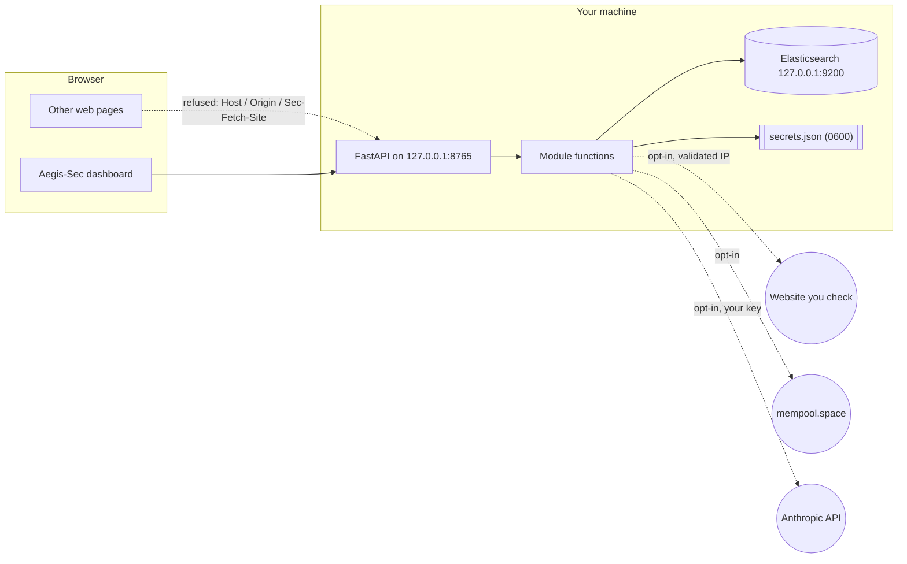

# Security model

This page explains what Aegis-Sec protects, what it assumes, and where its protections stop. Read it before you run Aegis-Sec on a shared machine, expose the dashboard beyond loopback, or feed it files and rules from people you do not trust. It is written for users who want to know what leaves their computer, and for reviewers who want to check the claims against the code. Each mitigation names the file that implements it.

To report a vulnerability, see [SECURITY.md](../SECURITY.md).

## What Aegis-Sec is

Aegis-Sec is a single-user tool that runs on your own computer. It has two front ends over one set of module functions:

- the `aegis-sec` CLI;
- a FastAPI server, started by `aegis-sec dashboard`, that serves a bundled React dashboard and a JSON API on `127.0.0.1:8765`.

There are no accounts, no database and no background jobs. Detection repair talks to a local Elasticsearch container. Two features reach the internet, and both only when you ask: the website check contacts the site you name, and the Bitcoin module contacts mempool.space and the Anthropic API.

## Assets

| Asset | Why it matters |
| --- | --- |
| Your machine and local network | A local server can be abused to attack the host or reach internal services. |
| Files you analyse, rules and fixtures | They may hold private data, and they may be hostile. |
| Your Anthropic API key | It costs money and identifies your account. |
| Your Bitcoin addresses | Revealing them together can link them to you. |
| Integrity of results | A wrong "repaired" or "safe" result leads to bad decisions. |

## Adversaries and threats

| Adversary | Example threats |
| --- | --- |
| A web page open in your browser | DNS rebinding against the local server; cross-site form posts (CSRF); framing the dashboard |
| A hostile file, rule, mapping or fixture | YAML alias bombs and tag-based object construction, deeply nested JSON, oversized input, path traversal in case IDs or upload names, decoder bugs in image parsing |
| A website you check, or its DNS | Redirects to internal addresses (SSRF), DNS answers that change between check and connect, oversized responses |
| An upstream service (mempool.space, Anthropic) | Malformed or oversized responses; a model that returns invented addresses or follows instructions hidden in your message |
| Another local user or process | Reading stored secrets; calling the unauthenticated local API |

## Trust boundaries

Data crosses a boundary at each of these points:

1. Browser to local server.
2. User input to parser.
3. Core to the local engine.
4. Core to the internet.
5. Model output back into Aegis-Sec.

## Mitigations

### Local server

| Control | Implementation |
| --- | --- |
| Binds to `127.0.0.1` by default | `dashboard` command in [`cli.py`](../src/aegissec/cli.py) |
| `Host` must be `127.0.0.1`, `localhost` or `[::1]` (HTTP 421 otherwise), which blocks DNS rebinding | `_LocalOnly` in [`server/app.py`](../src/aegissec/server/app.py) |
| Non-`GET`/`HEAD`/`OPTIONS` requests refused when `Sec-Fetch-Site` is cross-site or `Origin` is not an allowed host (HTTP 403) | `_LocalOnly._cross_site` in [`server/app.py`](../src/aegissec/server/app.py) |
| No CORS headers, so other origins cannot read responses | [`server/app.py`](../src/aegissec/server/app.py) (no CORS middleware) |
| Declared body size capped per route (1 MiB default, 60 MiB detect run, 51 MiB file upload) | `MAX_BODY_BYTES`, `LARGE_BODY_ROUTES` in [`server/app.py`](../src/aegissec/server/app.py) |
| Upload size counted while streaming; file held in an anonymous spooled temp file and never executed | [`forensics/api.py`](../src/aegissec/forensics/api.py) |
| Strict CSP, `frame-ancestors 'none'`, `X-Frame-Options: DENY`, `nosniff`, `no-referrer`, COOP `same-origin` on every response | `_SECURITY_HEADERS` in [`server/app.py`](../src/aegissec/server/app.py) |
| Static file paths resolved and confined to the bundle directory | `spa` route in [`server/app.py`](../src/aegissec/server/app.py) |
| Errors returned as `{reason, detail}`, never stack traces | Exception handler in [`server/app.py`](../src/aegissec/server/app.py) |

### Untrusted input

| Control | Implementation |
| --- | --- |
| YAML loaded with a safe loader that also refuses aliases, explicit tags and duplicate keys; one document; 100 KiB; depth 16 | [`core/safe_load.py`](../src/aegissec/core/safe_load.py) |
| JSONL bounded at 250 MiB per file, 1 MiB per line, depth 16 | [`core/safe_load.py`](../src/aegissec/core/safe_load.py) |
| Sigma rules parsed against an explicit allowlist; anything else rejected with a reason code | [`detect/rule.py`](../src/aegissec/detect/rule.py) |
| Repair candidates validated as a strict envelope, bounded to 3 AST edits, re-parsed after patching | [`detect/candidate.py`](../src/aegissec/detect/candidate.py) |
| Case IDs resolved and confined to the bundled cases directory | [`detect/cases.py`](../src/aegissec/detect/cases.py) |
| The engine loader writes only to disposable `cg-replay-*` indexes and deletes them after each run | [`detect/engine.py`](../src/aegissec/detect/engine.py) |
| Rule text, event data and model text are data. No content is evaluated, executed or followed as instructions | Throughout; the dashboard renders them as text |
| Uploaded file names reduced to a printable base name | `display_name` in [`forensics/analysis.py`](../src/aegissec/forensics/analysis.py) |
| Image metadata read with Pillow restricted to four formats, pixel data never decoded, a pixel-count ceiling | [`forensics/exif.py`](../src/aegissec/forensics/exif.py) |
| URL forensics never fetches or resolves the URL | [`forensics/url.py`](../src/aegissec/forensics/url.py) |

### Outbound requests

| Control | Implementation |
| --- | --- |
| Only `http`/`https` with a host, at most 2,048 characters, no credentials in the URL | `check_url` in [`core/netguard.py`](../src/aegissec/core/netguard.py) |
| Every resolved address must be global unicast: no private, loopback, link-local (including cloud metadata), multicast or reserved ranges, including IPv4 embedded in IPv6 (mapped, 6to4, NAT64, IPv4-compatible). `--allow-private` lifts this for one run. | [`core/netguard.py`](../src/aegissec/core/netguard.py) |
| Website check connects to the validated IP, keeping the hostname in `Host` and SNI, so DNS changes after the check cannot redirect it | [`webcheck/fetch.py`](../src/aegissec/webcheck/fetch.py) |
| Each redirect re-validated; at most 5; 10 s total; 1 MiB read per response; no environment proxies | [`webcheck/fetch.py`](../src/aegissec/webcheck/fetch.py) |
| mempool.space lookups validated, no redirects, 10 s timeout, 64 KiB response cap, schema-checked | [`bitcoin/chain.py`](../src/aegissec/bitcoin/chain.py) |
| Engine client never follows redirects | [`detect/engine.py`](../src/aegissec/detect/engine.py) |

### Model output

| Control | Implementation |
| --- | --- |
| The guardian only classifies a message into a fixed schema. It cannot run commands or move funds. | [`bitcoin/guardian.py`](../src/aegissec/bitcoin/guardian.py) |
| Addresses from the model are kept only if they appear verbatim in your message and pass the local parser | `_validated_addresses` in [`bitcoin/guardian.py`](../src/aegissec/bitcoin/guardian.py) |
| The next-step text comes from Aegis-Sec; the model summary is labeled as model-written and cut to 500 characters | [`bitcoin/guardian.py`](../src/aegissec/bitcoin/guardian.py), [`bitcoin/cli.py`](../src/aegissec/bitcoin/cli.py) |

### Result integrity

| Control | Implementation |
| --- | --- |
| The pinned engine is the only matching oracle; the version is checked on every run | [`detect/engine.py`](../src/aegissec/detect/engine.py) |
| Engine and conversion errors are reported as errors with `counts: null`, never as zero matches | [`detect/replay.py`](../src/aegissec/detect/replay.py) |
| Pagination retrieves every hit, or fails | `search_ids` in [`detect/engine.py`](../src/aegissec/detect/engine.py) |
| The candidate is selected on development fixtures and frozen before validation; validation fixtures must share no events with development | [`detect/workflow.py`](../src/aegissec/detect/workflow.py) |
| Explicit `abstained`, `unsupported` and `insufficient_evidence` outcomes instead of a forced answer | [`detect/workflow.py`](../src/aegissec/detect/workflow.py) |
| Evidence written as content-addressed JSON with an atomic rename | [`core/evidence.py`](../src/aegissec/core/evidence.py) |
| Heuristic scores labeled as heuristics, not probabilities | [`forensics/models.py`](../src/aegissec/forensics/models.py) |

## How secrets are stored

The only secret is the optional Anthropic API key ([`core/config.py`](../src/aegissec/core/config.py)).

- **Lookup order.** `ANTHROPIC_API_KEY` from the environment first, then the `anthropic_api_key` entry in `secrets.json`.
- **Location.** `secrets.json` lives in the config directory:
  - `$AEGIS_SEC_HOME` if set;
  - otherwise `%APPDATA%\aegis-sec` on Windows;
  - otherwise `$XDG_CONFIG_HOME/aegis-sec`, which defaults to `~/.config/aegis-sec`.
- **Permissions.** The directory is created or tightened to `0700`. The file is written to a new `0600` temporary file (created exclusively with `mkstemp`) and atomically renamed over the old one. On Windows these POSIX modes have limited effect, and the file relies on your profile's default permissions.
- **Format.** Plain JSON. The key is not encrypted and is not stored in the OS keychain. Anyone who can read files as your user can read it.
- **Setting it.** Use `aegis-sec config set-anthropic-key`, which reads the key without echoing it, or the dashboard settings page (`PUT /api/settings/anthropic-key`, a loopback request).
- **Clearing it.** Use `aegis-sec config clear-anthropic-key`, or send `null` to the same route.
- **Never returned.** `GET /api/settings` and `aegis-sec config show` report only whether a key is configured. Aegis-Sec does not write the key to logs or evidence, and it is sent only to the Anthropic API.

## Known limitations

- **Single local user, no authentication.** Any process or user on the machine that can reach `127.0.0.1:8765` can call every route. That includes replacing or clearing the stored API key and running scans that send data to the internet. The key cannot be read back through the API. Do not run the dashboard on a machine you share with people you do not trust.
- **Binding beyond loopback.** `aegis-sec dashboard --host <interface>` adds that host name to the allowlist and serves the same unauthenticated API to the network. The traffic is plain HTTP. Keep the default unless you have a separate access control in front of it.
- **Browsers and Local Network Access.** Aegis-Sec does not rely on Chrome's Local Network Access (LNA) permission prompt. Browsers without LNA can send requests from any page to `127.0.0.1`, and a user may grant LNA to a page. In both cases the server's own `Host`, `Origin` and `Sec-Fetch-Site` checks still apply. `GET` routes are not refused cross-site, but they have no side effects, and without CORS headers the page cannot read their responses.
- **Guardian output is unverified model text.** `intent` and `model_summary` come from a language model and can be wrong. Prompt injection in your own message can change them. The next step is fixed text from Aegis-Sec, but you should still read it before running any command. Your message is sent to Anthropic.
- **Chain lookups disclose addresses.** `--lookup-chain` sends addresses and your IP to mempool.space. The mempool.space client validates the URL but connects by hostname, unlike the website check, which connects to the validated IP. The target is a fixed public host, so this matters less there.
- **The local engine is unauthenticated.** `detect engine-up` runs Elasticsearch with security disabled on `127.0.0.1:9200`. Local processes can read a replay index while a run is in progress. If a run is killed abruptly, a `cg-replay-*` index can be left behind until you delete it.
- **Evidence files are not access-restricted.** `--evidence-dir` writes reports with your default file permissions. A report holds the full rule and mapping text, field names and counts from the schema profile, matched event IDs, and benign context values used in noise exclusions.
- **Image parsing.** EXIF reading parses untrusted image headers with Pillow. Restricting formats and pixel counts narrows the exposure, but a Pillow vulnerability in header parsing remains a residual risk. Without the `[exif]` extra, Pillow is not used.
- **Heuristics are not verdicts.** The URL score, entropy findings and website grade are signals. A clean result does not mean a file, link or site is safe.
- **Validation covers only its suite.** A `repaired` outcome shows behavior on the labeled scenarios you supplied. The bundled cases are synthetic.
- **The development tooling is not a sandbox.** The Claude Code configuration in `.claude/` denies edits to secrets and protected data paths and blocks writes outside the project. It does not intercept shell commands.
